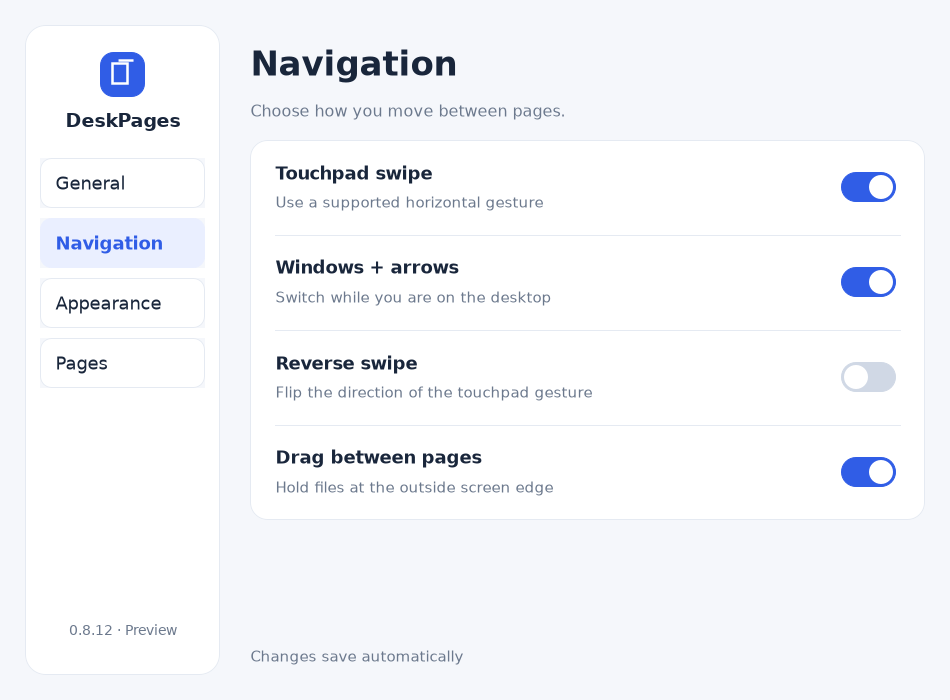
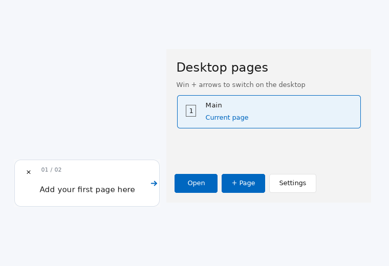

# DeskPages — Windows 11 Desktop Icon Organizer

DeskPages organizes icons on your original Windows 11 desktop into separate pages for work, study and personal projects. Files keep their original paths; your wallpaper, taskbar and open application windows stay in place.

Created by **Adam Abu Toamy** · **Windows 11 x64** · **Alpha**

<!-- deskpages-download:start -->
## Download

[**Download DeskPages 0.8.19 for Windows 11 x64 — EXE installer**](https://github.com/AdamAbuToamy/DeskPages/releases/download/v0.8.19-alpha.1/DeskPages-Setup-0.8.19.exe)

Published installer and source: **0.8.19 Alpha**.
<!-- deskpages-download:end -->

You only need the EXE installer. Release notes, source and SHA-256 checksums are available under [Releases](https://github.com/AdamAbuToamy/DeskPages/releases). This Alpha is unsigned; Windows may display an unknown-publisher or SmartScreen warning.

## What's new in 0.8.20 (experimental)

Optional **Taskbar groups** from the DeskPages tray menu organize currently running windows under native numbered taskbar buttons. The add button appears near weather; hover uses Windows previews. This preview requires device testing before release. See [taskbar experiment](Release/TASKBAR-GROUPS.md).

## What's new in 0.8.19

- Edge dragging stays available after a delayed agent reply, with safe cancellation and no replayed navigation.
- Dedicated input monitoring and a polling fallback recover missed drag starts.

## What's new in 0.8.18

- Pinned icons show names and their own icons, without full paths.
- General settings show current RAM use as a percentage of physical memory and in MB, replacing the benchmark action. Sampling stops when the indicator is hidden.

## What's new in 0.8.17

- Original app branding in settings, and a Pinned icons manager under Settings → Pages.
- Responsive installer actions with safe cancellation before file replacement.
- Automatic GitHub update checks and notifications, plus a manual check in Settings → General. Disable automatic checks in the update window. Users on 0.8.16 or earlier need one manual upgrade to get this feature.

## What's new in 0.8.16 (experimental)

- Optional cached page capture under **Settings → Appearance → Page capture**; direct capture remains the default.
- Persistent, compressed and current-user encrypted page snapshots, with no timed expiry. Valid local images can be restored after a RAM eviction or restart.
- Layout changes request a new snapshot after pointer release, without waiting for the next page switch.
- Touchpad gestures can queue during transitions; updated contact tracking and wheel fallback reduce missed input.
- A 240 ms eased animation in cached mode, with the page number dismissed when motion ends.
- The original experimental resource-comparison tool was replaced with a live memory indicator in 0.8.18.

Snapshots are saved locally in `%LOCALAPPDATA%\DeskPages\HiddenPages\Snapshots`. See [privacy information](PRIVACY.txt) and [experiment details](Release/SNAPSHOT-CACHE-EXPERIMENT.md). Physical Windows 11/touchpad acceptance and measured CPU, RAM and response-time results remain pending; no performance claim is established.

## What's new in 0.8.12

- Redesigned settings with a sidebar, four sections, grouped cards and consistent controls.
- English, Arabic and Hebrew layouts, with one explicit layout owner for text, controls and DPI scaling.
- Automatic saving, quick-tour replay, icon arrangement save/restore and display-scope rollback.
- Ordinary Explorer **Show > Hidden items** may stay enabled while other pages' managed icons remain hidden.

### Actual settings preview

*Captured from the actual UI using fixture data under Mono/Xvfb. Windows fonts and borders may differ.*

### Hidden items and shared storage

Off-page managed files use Hidden + System attributes. A durable ownership journal records which System bits DeskPages added before any file attribute changes. Opening the page, Show all, Rescue and uninstall remove app-owned bits; existing hidden/system items are not automatically adopted. No file contents or paths are changed.

Keep **Folder Options > View > Hide protected operating system files** enabled. Enabling protected-files display can expose off-page items; page switching reports the requirement without rewriting your Explorer preferences.

Pages organize one physical Desktop folder. They share disk space and the same filename namespace; they do not create separate drives or extra disk capacity. Keep `system-ownership.xml` with the saved page metadata. Use the updated Show all / Rescue before downgrading to 0.8.9, which does not understand the added System bits.

## What's new in 0.8.9

- A first-run guide points to the real **+ Page** button and advances after you add a page.
- Two animated cards demonstrate a two-finger touchpad swipe and **Win + Left / Right**.
- Replay from **Settings → General → Start the tour**.
- New installations start with **Main** only. Upgrades preserve existing pages; replay skips the add-page step when multiple pages already exist.
- English, Arabic and Hebrew, with reduced-motion support.

### Actual tour preview

*Captured from the actual UI with test data under Mono/Xvfb. Windows fonts and window borders may differ.*

## Getting started

1. Run the installer, then click the DeskPages icon beside the clock.
2. Add a page using **+ Page**, or follow the first-run guide.
3. On the desktop, use **Win + Left / Right** or a supported two-finger horizontal swipe.
4. Drag desktop files to an external screen edge to switch pages and place them.

Touchpad support depends on the device and driver. The tour does not enable input options you have disabled.

## Everyday features

- Separate pages on the original Explorer desktop.
- Slide animation, immediate navigation feedback and a translucent page indicator.
- Drag icons between pages without changing their file paths.
- Rename pages, lock icon positions and show selected icons on every page.
- Save and restore a known-good icon arrangement.
- Protected deletion: nonempty pages cannot be deleted.
- A separate, compact settings window with automatic saving.
- Extended-display animation and an optional **Main display only** mode.

Internal monitor boundaries remain available for ordinary dragging. Use an external edge or keyboard navigation to switch pages.

## ديسك باجيس — تنظيم سطح مكتب ويندوز

ينظّم DeskPages أيقونات سطح مكتب ويندوز 11 في صفحات للعمل والدراسة والمشاريع، مع إبقاء الملفات في مساراتها الأصلية. الإصدار 0.8.12 يضيف إعدادات بتصميم جديد، ويسمح بإظهار الملفات المخفية العادية مع إبقاء أيقونات الصفحات الأخرى مخفية. لإعادة الجولة: **الإعدادات ← عام ← ابدأ الجولة**. استخدم زر التحميل أعلى الصفحة.

## Concept video

https://github.com/user-attachments/assets/1604baac-4e1b-4fa8-92d0-7a5c943df32d

*AI-generated concept visualization; the actual tour preview is shown above.*

## Safety and privacy

No account, telemetry or cloud upload. See [Privacy](PRIVACY.txt), [License](LICENSE.txt) and [Third-party notices](THIRD-PARTY-NOTICES.md).

The app starts at sign-in on Main. Run `DeskPagesRescue.exe` if the agent is unavailable. Uninstall through Windows Settings; do not manually delete page metadata while icons are hidden. Saved arrangements contain organization and icon positions, not backups of file contents.

## Validation and known limitations

Settings and the tour have isolated policy and real-control tests in English, Arabic and Hebrew, including four UI scales, preference saving, rejected display-scope rollback, replay, completion persistence and reduced motion. Local UI evidence uses Mono/Xvfb. Real Windows installation, reboot, touchpad, Explorer/OLE, monitor/DPI and frame pacing require Windows acceptance; passing isolated tests is not a guarantee for every device.

Run `Validate.cmd` for automated checks and `Simulate-Monitors.cmd` for the interactive monitor-region simulator. See [Build instructions](Release/BUILD.md), [Acceptance checklist](Release/ACCEPTANCE.md) and [Release notes](Release/NOTES.md).

## More projects by Adam Abu Toamy

[**Where I Left Off — project and follow-up organizer**](https://where-i-left-off.web.app/about.html) helps you save where you stopped and what to do next across phone and PC. [Open the app](https://where-i-left-off.web.app/) · [Source on GitHub](https://github.com/AdamAbuToamy/where-i-left-off).
