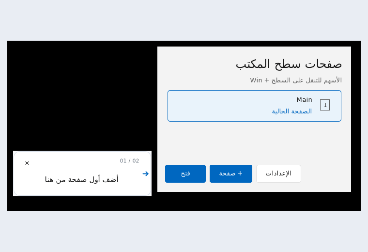

# DeskPages — Windows 11 Desktop Icon Organizer

DeskPages organizes icons on your original Windows 11 desktop into separate pages for work, study and personal projects. Files keep their original paths; your wallpaper, taskbar and open application windows stay in place.

Created by **Adam Abu Toamy** · **Windows 11 x64** · **Alpha**

<!-- deskpages-download:start -->
## Download

[**Download DeskPages 0.8.9 for Windows 11 x64 — EXE installer**](https://github.com/AdamAbuToamy/DeskPages/releases/download/v0.8.9-alpha.1/DeskPages-Setup-0.8.9.exe)

Published installer and source: **0.8.9 Alpha**.
<!-- deskpages-download:end -->

You only need the EXE installer. Release notes, source and SHA-256 checksums are available under [Releases](https://github.com/AdamAbuToamy/DeskPages/releases). This Alpha is unsigned; Windows may display an unknown-publisher or SmartScreen warning.

## What's new in 0.8.9

- A first-run guide points to the real **+ Page** button and advances after you add a page.
- Two animated cards demonstrate a two-finger touchpad swipe and **Win + Left / Right**.
- Replay from **Settings → Quick tour → Replay**.
- New installations start with **Main** only. Upgrades preserve existing pages; replay skips the add-page step when multiple pages already exist.
- English, Arabic and Hebrew, with reduced-motion support.

### Actual tour preview

*Captured from the actual UI with test data under Mono/Xvfb. Windows fonts and window borders may differ.*

## Getting started

1. Run the installer, then click the DeskPages icon beside the clock.
2. Add a page using **+ Page**, or follow the first-run guide.
3. On the desktop, use **Win + Left / Right** or a supported two-finger horizontal swipe.
4. Drag desktop files to an external screen edge to switch pages and place them.

Touchpad support depends on the device and driver. The tour does not enable input options you have disabled.

## Everyday features

- Separate pages on the original Explorer desktop.
- Slide animation, immediate navigation feedback and a translucent page indicator.
- Drag icons between pages without changing their file paths.
- Rename pages, lock icon positions and show selected icons on every page.
- Save and restore a known-good icon arrangement.
- Protected deletion: nonempty pages cannot be deleted.
- A separate, compact settings window with automatic saving.
- Extended-display animation and an optional **Main display only** mode.

Internal monitor boundaries remain available for ordinary dragging. Use an external edge or keyboard navigation to switch pages.

## ديسك باجيس — تنظيم سطح مكتب ويندوز

ينظّم DeskPages أيقونات سطح مكتب ويندوز 11 في صفحات للعمل والدراسة والمشاريع، مع إبقاء الملفات في مساراتها الأصلية. الإصدار 0.8.9 يضيف جولة تفاعلية قصيرة ورسومًا متحركة لتوضيح التنقل. لإعادتها: **الإعدادات ← الجولة التفاعلية ← إعادة**. استخدم زر التحميل أعلى الصفحة.

## Concept video

https://github.com/user-attachments/assets/1604baac-4e1b-4fa8-92d0-7a5c943df32d

*AI-generated concept visualization; the actual tour preview is shown above.*

## Safety and privacy

No account, telemetry or cloud upload. See [Privacy](PRIVACY.txt), [License](LICENSE.txt) and [Third-party notices](THIRD-PARTY-NOTICES.md).

The app starts at sign-in on Main. Run `DeskPagesRescue.exe` if the agent is unavailable. Uninstall through Windows Settings; do not manually delete page metadata while icons are hidden. Saved arrangements contain organization and icon positions, not backups of file contents.

## Validation and known limitations

The tour has isolated policy and real-control tests in English, Arabic and Hebrew, including replay, completion persistence and reduced motion. Local UI evidence uses Mono/Xvfb. Real Windows installation, reboot, touchpad, Explorer/OLE, monitor/DPI and frame pacing require Windows acceptance; passing isolated tests is not a guarantee for every device.

Run `Validate.cmd` for automated checks and `Simulate-Monitors.cmd` for the interactive monitor-region simulator. See [Build instructions](Release/BUILD.md), [Acceptance checklist](Release/ACCEPTANCE.md) and [Release notes](Release/NOTES.md).

## More projects by Adam Abu Toamy

[**Where I Left Off — project and follow-up organizer**](https://where-i-left-off.web.app/about.html) helps you save where you stopped and what to do next across phone and PC. [Open the app](https://where-i-left-off.web.app/) · [Source on GitHub](https://github.com/AdamAbuToamy/where-i-left-off).
